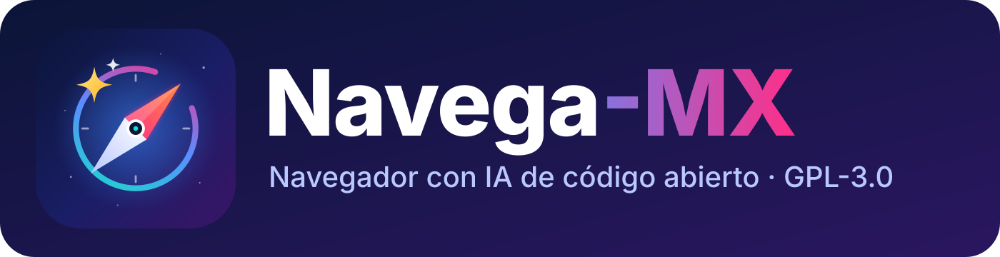

<p align="center"></p>

<p align="center">
  <b>Navegador web con inteligencia artificial de código abierto</b><br>
  macOS · Windows · Linux · Android — Licencia GNU GPL v3 o posterior
</p>

<p align="center">
  <a href="https://github.com/chago2850-blip/Navega-MX/releases/latest"><b>⬇ Descargar instaladores</b></a>
</p>

---

Navega-MX es un navegador con IA integrada, inspirado en la forma de trabajar de los
navegadores «agénticos» como Comet de Perplexity, pero **100 % libre** y con **modelos de IA
abiertos que corren en tu propio equipo**. No necesita cuentas, suscripciones ni enviar tus
datos a terceros.

## Funciones

| Función | Qué hace |
|---|---|
| **Asistente en panel lateral** (`Alt+A`) | Conversa sobre la página que estás viendo: resume, traduce, explica, extrae datos en tablas, redacta respuestas de correo. |
| **Chatea con tus pestañas** | Menciona pestañas con `@` o usa `/pestanas` y `/comparar` para sintetizar y comparar varias páginas a la vez. |
| **Motor de respuestas con fuentes** | Escribe una pregunta en la barra de direcciones (o empieza con `?`): Navega busca en la web, lee las fuentes y responde con citas numeradas `[1]`, tarjetas de fuentes y preguntas relacionadas. |
| **Agente que toma el control** | En modo *Agente* la IA navega, hace clic, escribe, llena formularios, elige opciones y desplaza la página por ti, mostrando cada paso en vivo. Puedes detenerlo en cualquier momento. |
| **Confirmación de acciones sensibles** | Antes de pagar, enviar, borrar o escribir en campos de contraseña, el agente te pide permiso. |
| **Tareas en segundo plano** | El agente puede trabajar en una pestaña oculta mientras sigues navegando; la pestaña *Tareas* muestra el progreso. |
| **Tareas programadas** | Ej. «cada lunes a las 8:00 resúmeme las noticias de tecnología». |
| **Atajos con `/`** | 12 atajos incluidos (`/resumir`, `/traducir`, `/puntos`, `/datos`, `/verificar`, `/agente`…) y tus propios atajos con variables `{texto}`, `{pagina}`, `{url}`, `{seleccion}`. |
| **Memoria con privacidad** | Tres modos: sin memoria, memoria local o memoria local + historial. Todo se guarda solo en tu equipo; puedes exportarlo o borrarlo. |
| **Modo de voz** | Dicta tus preguntas y escucha las respuestas (en Android usa el reconocimiento del sistema; en escritorio un servidor Whisper libre). |
| **Bloqueador de anuncios y rastreadores** | Motor libre Ghostery Adblocker (EasyList/EasyPrivacy) en escritorio y lista StevenBlack en Android, con lista blanca por sitio. |
| **Espacios de trabajo** | Agrupa pestañas por proyecto (Personal, Trabajo, Escuela…) y pide a la IA que las organice. |
| **Vista dividida** | Dos páginas lado a lado (`Ctrl+Shift+S`). |
| **Buscar pestañas** | `Ctrl+Shift+A` para encontrar cualquier pestaña abierta. |
| **Navegador completo** | Pestañas privadas, marcadores, historial, descargas, buscar en página, zoom, imprimir, guardar página, menú contextual con IA, restaurar sesión, tema claro/oscuro. |

## Inteligencia artificial de código abierto

Navega-MX no depende de ningún servicio privado. En **Ajustes → Inteligencia artificial** eliges el motor:

1. **Ollama (recomendado)** — instala [Ollama](https://ollama.com) y un modelo abierto:
   ```bash
   ollama pull qwen2.5:7b      # o llama3.2, gemma3, mistral, deepseek-r1, phi4…
   ```
   Navega detecta los modelos instalados automáticamente.
2. **Servidor compatible con la API de OpenAI** — llama.cpp `llama-server`, LM Studio, LocalAI, vLLM, Jan, KoboldCpp…
3. **IA integrada con WebGPU** (escritorio) — descarga una sola vez un modelo pequeño (Qwen 2.5, Llama 3.2, Phi 3.5, Gemma 2) que corre dentro del navegador con [WebLLM](https://github.com/mlc-ai/web-llm). No requiere instalar nada más.

**En Android** puedes usar el Ollama de tu computadora en la misma red: inicia Ollama con
`OLLAMA_HOST=0.0.0.0 ollama serve` y escribe en Ajustes `http://IP-de-tu-PC:11434`.

**Voz en escritorio:** configura un servidor de transcripción libre compatible con `/v1/audio/transcriptions`
(por ejemplo `whisper.cpp` server o Speaches) en *Ajustes → Voz*.

## Atajos de teclado (escritorio)

| Atajo | Acción |
|---|---|
| `Alt+A` | Abrir/cerrar el asistente |
| `Alt+S` | Resumir la página |
| `Alt+G` | Agente: hacer una tarea |
| `Alt+Shift+V` | Modo de voz |
| `Shift+Enter` en la barra | Preguntar a la IA en lugar de buscar |
| `Ctrl+T` / `Ctrl+W` / `Ctrl+Shift+T` | Nueva pestaña / cerrar / reabrir |
| `Ctrl+Shift+N` | Pestaña privada |
| `Ctrl+Shift+A` | Buscar pestañas |
| `Ctrl+Shift+S` | Vista dividida |
| `Ctrl+D` / `Ctrl+Shift+B` | Agregar marcador / ver marcadores |
| `Ctrl+H` / `Ctrl+J` | Historial / descargas |
| `Ctrl+F` | Buscar en la página |
| `Ctrl+1…9`, `Ctrl+Tab` | Cambiar de pestaña |

En macOS usa `Cmd` en lugar de `Ctrl`.

## Instalación

Descarga el instalador de tu sistema en [Releases](https://github.com/chago2850-blip/Navega-MX/releases/latest):

| Sistema | Archivo |
|---|---|
| Windows 10/11 | `Navega-MX-…-Windows-x64-Setup.exe` |
| macOS Apple Silicon / Intel | `Navega-MX-…-macOS-arm64.dmg` / `…-macOS-x64.dmg` |
| Debian, Ubuntu, Mint | `Navega-MX-…-Linux-amd64.deb` → `sudo apt install ./Navega-MX-*.deb` |
| Fedora, openSUSE, RHEL | `Navega-MX-…-Linux-x86_64.rpm` → `sudo dnf install ./Navega-MX-*.rpm` |
| Cualquier Linux | `Navega-MX-…-Linux-x86_64.AppImage` |
| Android 7+ | `Navega-MX-…-Android.apk` |

Los paquetes no están firmados con un certificado comercial. En macOS, la primera vez haz clic
derecho → **Abrir** (o ejecuta `xattr -cr /Applications/Navega-MX.app`). En Windows, en SmartScreen
elige **Más información → Ejecutar de todas formas**.

## Arquitectura

```
Navega-MX/
├── shared/navega/          ← núcleo de IA compartido por todas las plataformas
│   ├── core/ai.js          ← proveedores Ollama / OpenAI-compatible / WebLLM (streaming)
│   ├── core/answer.js      ← motor de respuestas: búsqueda + lectura de fuentes + citas
│   ├── core/agent.js       ← agente de navegación (observar → decidir → actuar)
│   ├── core/voice.js       ← dictado y lectura en voz alta
│   ├── core/store.js       ← ajustes, memoria, atajos, conversaciones (local)
│   ├── page/agent-dom.js   ← script de página: lectura, mapa de elementos y acciones
│   └── ui/                 ← asistente e inicio (HTML/CSS/JS)
├── desktop/                ← Electron (Chromium) para macOS, Windows y Linux
│   └── src/main.js, preload.js, app/browser.js …
├── android/                ← Kotlin + WebView, mismo asistente vía puente nativo
└── logo/                   ← logotipo (SVG/PNG)
```

El asistente se escribe una sola vez (`shared/`) y cada plataforma implementa el mismo
«puente» (`host`): pestañas, ejecución de scripts en la página, red sin CORS y voz.

## Compilar desde el código

**Escritorio** (Node.js 22):
```bash
cd desktop
npm install
npm start              # ejecutar en modo desarrollo
npm run dist:linux     # .deb, .rpm y .AppImage
npm run dist:win       # instalador .exe (NSIS)
npm run dist:mac       # .dmg para Intel y Apple Silicon
```

**Android** (JDK 17 + Android SDK):
```bash
cd android
gradle assembleRelease
```

Los instaladores se generan automáticamente con GitHub Actions al publicar una etiqueta `v*`.

## Privacidad

- La IA corre en tu equipo (o en el servidor que tú elijas).
- Memoria, conversaciones, historial y marcadores se guardan solo localmente.
- El contenido de las páginas se trata como datos, nunca como instrucciones para el agente.
- Las pestañas privadas no se guardan en el historial y se borran al cerrar.

## Componentes libres utilizados

- [Electron](https://www.electronjs.org/) / Chromium — MIT / BSD
- [Ghostery Adblocker](https://github.com/ghostery/adblocker) — MPL-2.0
- [WebLLM](https://github.com/mlc-ai/web-llm) — Apache-2.0
- [StevenBlack/hosts](https://github.com/StevenBlack/hosts) — MIT
- AndroidX WebKit — Apache-2.0

## Licencia

Copyright © 2026 Santiago Miguel.

Este programa es software libre: puedes redistribuirlo y/o modificarlo bajo los términos de la
**Licencia Pública General GNU** publicada por la Free Software Foundation, ya sea la versión 3
de la Licencia o (a tu elección) cualquier versión posterior. Consulta el archivo [LICENSE](LICENSE).

*Navega-MX es un proyecto independiente; no está afiliado a Perplexity ni a su navegador Comet.*
